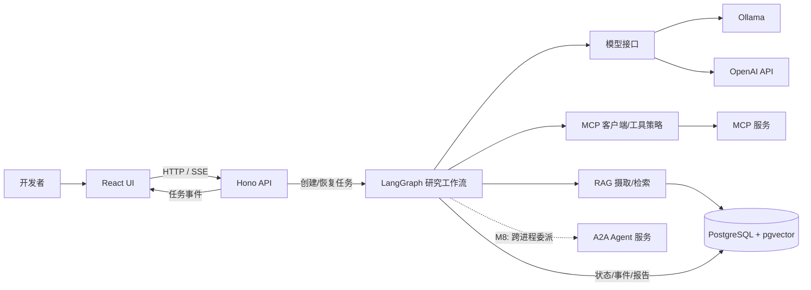

# AI Research Lab 架构（Milestone 0）

状态：已确认，按里程碑实施。核查日期：2026-10-05。

## 目标与首条纵向用例

输入研究问题（例如“WebAssembly 能否替代 Electron 应用的部分能力”），输出包含结论、证据、来源定位、局限和待核查点的报告。开发过程以可运行、可观察、可测试的最小阶段推进；本地 Ollama 应可支持基本路径，OpenAI 是可选配置。

## 技术栈

| 职责 | 选择 | 引入阶段 |
| --- | --- | --- |
| 工作流 | [LangGraph.js](https://docs.langchain.com/oss/javascript/langgraph/overview) `@langchain/langgraph`，只用于状态、路由、检查点和暂停 | M3 |
| 模型 | 官方 [OpenAI TypeScript SDK](https://github.com/openai/openai-node) `openai` 与 [Ollama JS](https://github.com/ollama/ollama-js) `ollama`，由应用接口隔离 | M2 |
| HTTP | [Hono](https://hono.dev/docs/getting-started/nodejs) + Node 适配器、[Zod](https://zod.dev/)；事件流用 [Hono SSE](https://hono.dev/docs/helpers/streaming) | M1、M3 |
| 前端 | [React + Vite + TypeScript](https://vite.dev/guide/) | M1 |
| 仓库/质量 | [pnpm workspace](https://pnpm.io/workspaces)、[Turborepo](https://turborepo.com/docs)、TypeScript strict、ESLint、Prettier、[Vitest](https://vitest.dev/guide/learn/writing-tests) | M1 |
| 持久化/RAG | PostgreSQL + [pgvector](https://github.com/pgvector/pgvector)；全文检索用 PostgreSQL 自身能力 | M5；持久检查点最迟 M9 |
| MCP | 官方 [TypeScript SDK v2](https://github.com/modelcontextprotocol/typescript-sdk) `@modelcontextprotocol/client` / `server` | M4 |
| A2A | 官方 [JS SDK](https://github.com/a2aproject/a2a-js) `@a2a-js/sdk` | M8 |

以上是技术方向，不在 M0 安装包或固定版本。M1/M2 安装时核对相互兼容的稳定版本并提交 lockfile；M4/M8 再实测当时的 MCP/A2A SDK 与规范版本。MCP v2 已是官方稳定线；A2A 官方 SDK 支持 Agent Card、任务和多种传输，但此时不需要其运行时成本。

## 组件与数据流



| 边界 | 责任 | 不承担 |
| --- | --- | --- |
| Hono | 请求验证、任务 API、鉴权入口、SSE、审批接口 | 智能体内部调度 |
| LangGraph | 状态转换、分支、循环上限、检查点、人工暂停 | 厂商模型协议、外部 HTTP 网关 |
| 模型接口 | 统一生成/流式/结构化输出与能力错误；模型名由配置给出 | 把不同模型能力假装完全相同 |
| RAG | 摄取、分块、索引、检索、来源与片段定位 | 把检索结果直接视为可信指令 |
| MCP | 工具发现/调用协议及权限策略 | 智能体间任务生命周期 |
| A2A | 独立服务间发现、委派、进度、消息、产物 | 进程内函数调用 |
| PostgreSQL | 任务、事件、来源、报告、向量，后期检查点 | 短期执行中的全部内存状态 |
| React | 进度、证据、消息、报告与人工操作 | 真实任务状态的权威来源 |

初期 Web 与 API 是两个本地进程；Research Agent、LangGraph、模型适配和工具策略位于 API 进程内。Ollama 独立运行。M5 加入本地 PostgreSQL；M8 才将有独立职责的 Agent 拆成 A2A 服务。首次只保留一个 Research Agent；Coordinator、Critic 或来源专员须经真实职责评估后创建。

## 概念契约

- `ResearchTask`：任务 ID、问题、状态、时间、预算/取消信息。
- `ResearchEvent`：任务 ID、递增序号、时间、事件类型、关联 ID、脱敏载荷；供日志、SSE 与 UI 使用。
- `Source` / `Evidence`：来源 URL 或本地路径、标题、获取时间、内容哈希、片段位置、提取文本。
- `Report`：结论、逐项证据引用、局限和未解决问题；引用指向稳定的 `Evidence` ID，而非模型生成的任意 URL。
- 短期记忆是工作流状态；检查点支持恢复；长期知识是可检索来源；事件日志用于审计。四者分别建模。

每个外部调用应有超时和取消信号；有副作用的工具调用需要幂等键或审批。SSE 是任务事件的投影，断线后按事件序号补载。流式连接断开不应自动删除任务。具体 API/表结构留在引入它们的里程碑确定。

## 仓库结构（按阶段创建）

```text
apps/
  api/                 # Hono；初期内含 research、model、tool、rag 模块
  web/                 # React/Vite；M1 只显示最小健康状态
packages/
  contracts/           # 前后端共享的事件与请求 schema（确需共享时创建）
docs/
  architecture.md
  decisions/
docker-compose.yml     # M5 引入 PostgreSQL 时创建
pnpm-workspace.yaml
turbo.json
```

不预建 `agents/*`、`services/*`、`packages/a2a`、`packages/mcp` 等空目录。跨应用复用或独立部署实际出现时再提取包/服务。依赖方向：Web/API → contracts；API 的工作流 → 模型/工具/RAG 接口；协议 SDK 只在适配层出现。

## 验证、观察与安全

- 用 fake model / fake agent 验证路由、状态、停止条件和报告组装；真实模型测试为可选集成测试。Vitest 不负责类型检查，另运行 `tsc`。
- M1 起记录任务 ID、关联 ID、事件名、时间与错误码；不得在日志写密钥、完整私有文档或未经处理的模型上下文。可选 OpenTelemetry，核心链路不依赖专有平台。
- 外部文档和工具结果是数据而非指令。工具按白名单、参数、URL/文件范围和预算授权；默认无 shell 或任意文件系统访问。敏感操作在 M10 暂停审批。
- M12 使用固定问题、预期证据/来源/结论评估检索、引用、依据充分性、完成率、时延和成本。

## 主要风险与待验证点

1. 本地模型对工具调用和严格 JSON 的支持因模型而异；M2 用能力探测与明确失败验证，不保证任意 Ollama 模型都可完成全流程。
2. LangGraph 节点恢复可能重放节点，M3 起避免在可重放节点中直接进行不可幂等的副作用；M9 验证数据库检查点与恢复。
3. pgvector 与 PostgreSQL 全文检索可共用存储，但混合排序、中文分词、召回率须在 M5/M12 用语料实测；不预称其优于 Qdrant。
4. MCP/A2A 协议和 SDK 仍演进；M4/M8 锁定兼容版本并做协议集成测试。跨服务认证、取消与事件映射需单独验证。
5. 网络来源质量和版权/访问限制不同；先用固定本地文档验证引用链，再接搜索与论文来源。

## 阶段推进

M1 基础仓库/API/UI → M2 模型接口 → M3 单 Research Agent → M4 MCP 工具 → M5 本地 RAG → M6 Agentic RAG → M7 基于实测职责拆 Agent → M8 真实 A2A → M9 有上限的研究循环与持久恢复 → M10 人工介入 → M11 过程 UI → M12 评估与追踪。每阶段按 [`step.md`](../step.md) 交付并等待开发者验证。

**M1 的精确目标：** 创建可安装、可启动、可检查的 pnpm/Turborepo TypeScript 仓库；Hono 提供健康端点，React 页面显示该端点结果；严格类型、格式、lint、测试和最小运行说明全部通过。不接模型、数据库、MCP 或 A2A。

## 决策与未决问题

见 [`decisions/`](decisions/)。后续需要你决定：首个外部搜索源及其账户/配额、论文与 GitHub 内容的使用范围、是否需要多用户鉴权、预计本地硬件与优先支持的 Ollama 模型。这些不阻塞 M1。
