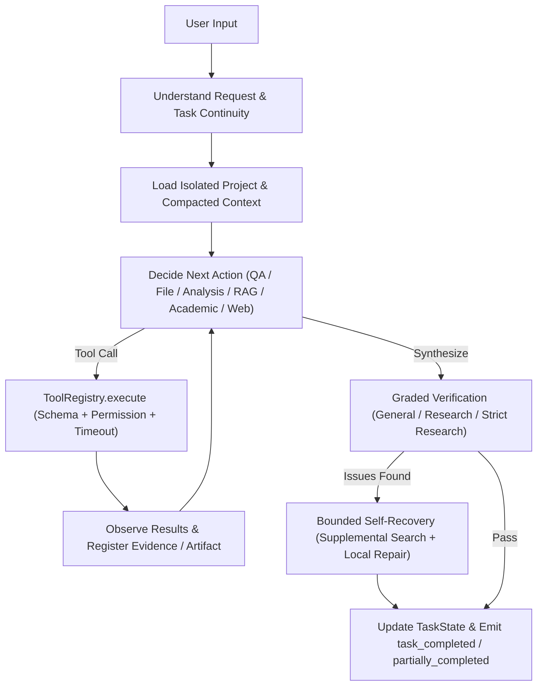

# Atlas 通用科研智能体架构审计与重构文档

## 1. 仓库级审计与根因分析清单

| 编号 | 问题现象 | 原始代码位置 | 原有行为与根因 | 修改方案与兼容性设计 |
| --- | --- | --- | --- | --- |
| **#1** | **跨项目/跨任务上下文污染**（在项目 A 研究“为什么花是红色的”，切换到项目 B 询问“Atlas 有哪些 UX 改进点”时继续输出红花报告） | `apps/api/src/human/service.ts:77-84`、`apps/api/src/research/loop.ts:165`、`apps/api/src/research/report.ts:121-142`、`apps/api/src/rag/store.ts:53-55` | 1. `HumanService.start()` 无条件将最近 3 轮历史（含 20,000 字红花报告及来源）拼接硬编码指令 `"Continue this research project and revise its report..."` 注入 `question`。<br>2. `savedReport()` 在新轮次未产出新报告时直接回退返回上一轮的 `previous.report`（红花报告）与 `previous.snapshot.state.sources`。<br>3. `VectorStore` 的 `rag_chunks` 表全局共享，无 `projectId` 隔离与领域相关性过滤。 | 1. 实现 `ContextManager`（`apps/api/src/agent/context.ts`），严格隔离 `ProjectContext`、`ProjectKnowledgeBase`、`TaskState`、`RetrievedContext` 与 `AgentWorkingMemory`。<br>2. 修复 `HumanService.start()` 与 `savedReport()`，仅在同一主题连续追问时继承上一轮报告。<br>3. 为 `VectorStore` 与 `RagService` 增加 `projectId` 隔离与相关性过滤。 |
| **#2** | **所有任务强制走固定科研循环与固定报告模板** | `apps/api/src/research/loop.ts:242-642`、`apps/api/src/research/loop.ts:126-146` | 默认循环固定为 `planning -> research -> analyze -> critique -> publish`，且 `renderAnalysis()` 强制将输出格式化为 `## 观察（原文所述） / ## 推断（需核验）`；普通问答、文件操作、代码分析均被当作取证任务处理。 | 新增通用执行循环 `AtlasAgentRuntime`（`apps/api/src/agent/runtime.ts`），根据任务意图动态路由 `qa`、`file_operation`、`project_analysis`、`literature_discovery`、`research_review`、`report_edit` 等，保留原有 `/api/research/*` 接口向后兼容。 |
| **#3** | **单条引文或逐字匹配失败即丢弃整份报告或终止任务** | `apps/api/src/research/workflow.ts:108-115`、`apps/api/src/research/loop.ts:429-470` | `workflow.ts` 在发现单个未知引用时直接抛出 `MODEL_INVALID_OUTPUT` 终止流；`loop.ts` 在 `analyze` 阶段若任意 `quote` 非严格子串则清空全部 `findings: []` 并设 `stop` 终止审查。 | 实现 Claim-Evidence 分离与分级验证器（`apps/api/src/agent/verification.ts`），支持 `general`、`research`、`strict_research` 三级策略及 `repairReportLocally()` 局部修复，保留有效结论。 |
| **#4** | **缺乏真实文件写入与工作区工具** | `apps/api/src/mcp/documents.ts:19-58` | 仅支持只读读取 `docs/decisions` 下不超过 24KB 的 `.md` 文件，无 `write_file`、`edit_file`、`list_directory`、`search_files`、`create_directory`。 | 实现工作区工具集（`apps/api/src/agent/workspace-tools.ts`），统一路径穿越防护（`resolveWorkspacePath`）、权限检查、写后磁盘读回校验（SHA-256）与 `ArtifactRecord` 追踪。 |
| **#5** | **RAG 仅支持单一稠密向量检索且无相关性判定** | `apps/api/src/rag/store.ts:119-143`、`apps/api/src/rag/service.ts:94-110` | 仅执行 `pgvector` 余弦距离检索，无查询改写、BM25 稀疏检索、RRF 混合融合、重排序及跨领域无关片段剔除；当 Ollama 不可用时直接失败。 | 实现 `apps/api/src/rag/hybrid.ts` 与 `rag.searchKnowledgeBase()`，支持中英双语分词、BM25、Dense、Hybrid RRF、Reranking、父子块扩展、去重、相关性过滤，并在 Embedding 故障时自动降级至 BM25。 |
| **#6** | **流式研究路由在子阶段超时后仍发送 `AGENT_COMPLETED`** | `apps/api/src/research/routes.ts:58-123` | `runResearchLoop` 内部 `workDeadline` 在总时限 80% 处触发 `RESEARCH_STOPPED (code: timeout)` 并回退到 `publish`，导致外层 `routes.ts` 在未达 100% 时限时误发 `AGENT_COMPLETED`。 | 在 `routes.ts` 中捕获 `RESEARCH_STOPPED` 的 `timeout` 状态并以 `AGENT_FAILED (MODEL_TIMEOUT)` 终止流，确保超时契约一致。 |

---

## 2. Agent Runtime 与工具架构

### 2.1 通用执行循环（`apps/api/src/agent/runtime.ts`）



### 2.2 显式任务状态机与错误恢复（`apps/api/src/agent/types.ts`、`apps/api/src/agent/tools.ts`）

- **状态集合**：`created`、`running`、`waiting_for_tool`、`waiting_for_user`、`recovering`、`completed`、`partially_completed`、`failed`、`cancelled`。
- **独立状态字段**：`currentStep`、`completedSteps`、`pendingSteps`、`blockingReason`、`failureCategory`、`evidenceSufficiency`、`requiresUserConfirmation`、`lastValidOutput`、`resourceUsage`、`artifacts`、`verification`。
- **错误分类**：`tool_error`、`network_error`、`model_error`、`schema_error`、`retrieval_error`、`evidence_error`、`permission_error`、`budget_exceeded`、`unrecoverable_error`。

---

## 3. RAG、Evidence Store 与学术工作流

1. **统一检索接口（`RagService.searchKnowledgeBase`）**：
   - 支持 `query`、`projectId`、`documentIds`、`filters`、`topK`、`strategy ("dense" | "bm25" | "hybrid")`。
   - 保留 Ollama 本地 Embedding 与 OpenAI Embedding 配置兼容。
2. **统一证据库（`EvidenceStore`）与分级验证（`verifyDraftAndClaims`）**：
   - 统一管理 `rag`、`web`、`paper`、`file` 四类来源证据，包含 `locator`（页码、章节、字符偏移、行号）。
   - 分离 `Claim` 与 `Evidence`，支持检测缺失来源、无法定位引文、无关证据、夸大推论（如把规划表述为已实现）、证据冲突及仅摘要限制。
3. **学术文献发现与论文结构化解析（`apps/api/src/agent/academic-tools.ts`）**：
   - `discover_literature`：接入 OpenAlex、Crossref、Semantic Scholar、arXiv，支持按 DOI/归一化标题去重，区分 `preprint` 与 `peer_reviewed`。
   - `parse_paper`：提取标题、作者、年份、DOI、摘要、章节、Markdown 表格（含跨页表检测）、LaTeX 公式、图注、脚注与参考文献，并保留双栏交错或损坏字形的原 PDF 页码与偏移定位（`unparsedRegions`）。

---

## 4. 数据库迁移与兼容性说明

- `VectorStore.initialize()` 采用向后兼容的幂等建表策略：
  - 保留原有 `rag_index` 与 `rag_chunks (id, metadata, embedding)` 表结构，所有既有数据无需清空即可直接读取。
  - 新增 `rag_documents (project_id, id, name, content, sha256, embedding_key, updated_at)` 表，用于保存项目级原始文档、支持按项目隔离、文档更新与删除。

---

## 5. 测试与评估说明

运行全量类型检查、构建与测试：

```bash
pnpm typecheck
pnpm build
pnpm test
```

新增回归测试位于 `apps/api/test/atlas-refactor.test.ts`，完整覆盖：
- **Case A**：任务切换与跨项目上下文隔离（植物学红花研究 vs Atlas UX 改进）
- **Case B**：引文校验失败后的局部修复与有界恢复
- **Case C**：真实文件保存、写后磁盘校验及权限异常拦截
- **Case D**：普通概念问答（`解释什么是 React Fiber`）不强制触发 RAG 与科研报告模板
- **Case E**：RAG 检索无结果时的诚实不确定性标注与防幻觉引用
- **Case F**：跨轮任务连续性（生成报告 → 仅修改结论章节 → 保存文件 → 继续补充引用）
- **Case G**：模型与工具故障注入（OpenAI 超时重试、Ollama 离线自动降级 BM25、文件权限拒绝、Schema 错误恢复）
