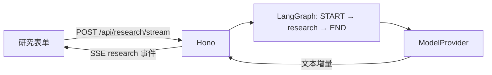

# Milestone 3：单个 Research Agent

配置 `apps/api/.env` 后运行 `pnpm dev`，打开 http://localhost:5173，输入问题并点击“开始研究”。应看到任务 ID、running 状态和逐步出现的报告，最终变为 completed；点击“取消”应停止当前请求。模型未配置、不可用或超时会显示错误。

`research/workflow.ts` 定义 question/report 状态和单个研究节点，节点调用 M2 的 provider。`research/routes.ts` 管理任务 ID、事件序号、截止时间与日志。前端按 SSE 事件更新状态，断流但没有终态视为失败。

每条事件包含 `taskId`、`sequence`、`timestamp` 和 `type`。正常顺序是 `TASK_CREATED → AGENT_STARTED → REPORT_DELTA* → AGENT_COMPLETED`；失败以 `AGENT_FAILED` 结束。用户取消通过请求 AbortSignal 传到模型，服务端记录 `TASK_CANCELLED`。日志不记录问题或报告正文。

这一步为模型调用增加明确的研究职责、状态与执行生命周期。它仍是一次模型生成，尚无工具选择或自主研究循环；因此只产出初步分析，不能声称已检索、核验或提供真实证据引用。

任务当前只存在于一次请求中：取消或断开页面会中止执行，重启后不可恢复，没有历史查询或重连回放。这是到持久任务存储引入前的临时边界；架构中的后台任务与事件回放尚未实现。

验证命令沿用 README。新增测试覆盖事件顺序、报告汇总、失败、超时、取消、SSE 分块与前端提交/取消。
