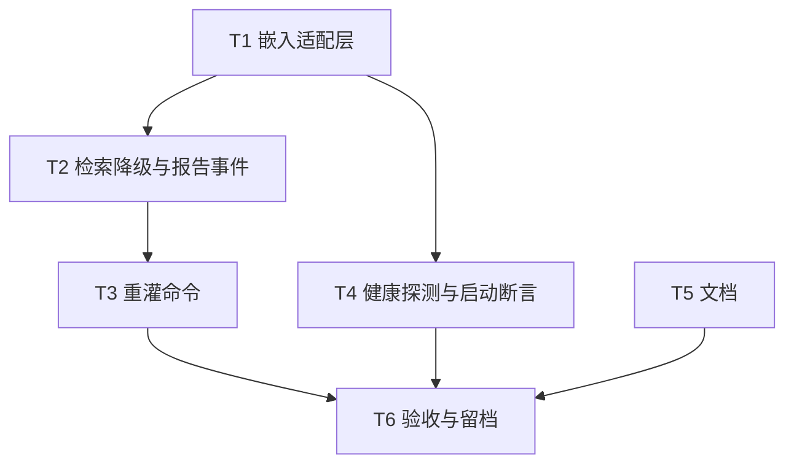

# 外部嵌入服务与无 Ollama 运行：任务图

对应 spec：[0001-external-embedding.md](./0001-external-embedding.md)

本地任务图，不使用 issue tracker。每个任务一个分支一个 worktree，实现完成后合入集成分支 `spec/0001-external-embedding`。

## 依赖关系

## 前沿

第一批可同时开工：T1、T5。

---

## T1 嵌入适配层

依赖：无。阻塞 T2、T4。

范围：

- `Embedder` 接口的 `embed` 增加 `kind: "query" | "document"` 参数
- 提供方枚举扩展为 `ollama | openai | voyage | jina`，新增 `EMBEDDING_API_KEY`
- 新增 OpenAI 兼容嵌入适配器，按提供方映射附加字段：voyage 用 `input_type`，jina 用 `task`，维度参数分别为 `output_dimension` 与 `dimensions`，openai 不附加
- 三家统一关闭截断：voyage 用 `truncation: false`，jina 用 `truncate: false`
- 适配器接受可注入的 `fetchImpl`
- 关闭 SDK 自身重试，外层只对 429 与 5xx 重试，最多 2 次，尊重 `Retry-After`，等待设上限
- 维度校验失败时错误信息包含实际维度与期望维度
- `.env.example` 默认改为 voyage，Ollama 段落移入注释
- `index.ts` 的配置指纹变量清单补上新变量

验收：

- 注入 fetch 断言 voyage 分支请求体含 `input_type` 与 `output_dimension`，jina 分支含 `task` 与 `dimensions`，openai 分支不含附加字段
- `kind` 为 query 与 document 时映射值正确
- 429 连续两次后 200 时共发出 3 次请求且返回成功
- 400 时只发 1 次并抛带状态码的错误
- 维度不匹配时错误信息同时包含实际值与期望值

测试先例：`apps/api/test/provider-adapters.test.ts`、`apps/api/test/embedding.test.ts`。

---

## T2 检索降级与报告事件

依赖：T1。阻塞 T3。

范围：

- `RagService` 的单查询检索与统一知识库检索，在嵌入调用失败时改为降级到稀疏检索并返回结果，结果对象带 `degraded` 与 `degradedReason`
- 稀疏检索也无命中时返回空集合并保留降级标记
- 非嵌入类故障（数据库不可用等）仍抛出检索错误
- 移除 `AtlasAgentRuntime` 里因服务层降级而冗余的稀疏检索重试分支
- 报告正文末尾追加「检索说明」段落，重复生成不叠加
- 新增 `RETRIEVAL_DEGRADED` 事件，在降级发生时发出
- 事件契约文档补上该事件

验收：

- 假嵌入器抛错时，检索返回稀疏命中的结果且 `degraded` 为真
- 数据库故障时仍抛检索错误
- 研究循环在降级时发出 `RETRIEVAL_DEGRADED` 事件，报告含「检索说明」
- 正常检索时既无降级标记也无该事件

测试先例：`apps/api/test/rag.test.ts`、`apps/api/test/loop.test.ts`、`apps/api/test/atlas-refactor.test.ts`。

---

## T3 重灌命令

依赖：T2。

范围：

- 仓储层新增「列出全部已存文档」的方法
- `RagService` 新增重灌方法：先按资料目录全量替换，再从已存文档重建片段与向量并追加到同一索引配置
- 新增可执行脚本与包脚本 `rag:reindex`
- 重灌前打印新旧索引配置摘要，重灌后打印文档数、片段数、降级次数与耗时
- 索引配置不匹配的报错文案指向该命令

验收：

- 先以旧嵌入器建索引并上传一份文档，换成新嵌入器后执行重灌，资料目录与已上传文档都能被检索到
- 重灌后 `rag_documents` 行数不变
- 重灌前后索引配置不同的情况下不抛错，重灌后检索正常

测试先例：`apps/api/test/rag.test.ts` 的 PGlite 用法。

---

## T4 健康探测与启动断言

依赖：T1。

范围：

- 知识库健康检查增加可选探测参数，触发时对嵌入服务做一次真实请求，返回实际维度、期望维度与模型名
- 新增纯函数 `assertNoOllama(env)`，开关打开且任一提供方为 ollama 时抛出带明确信息的错误
- 启动时调用该断言，并在启动日志里输出生效的嵌入提供方、模型名与地址
- 环境变量示例补充开关说明

验收：

- 探测参数生效时返回实际与期望维度
- 未带探测参数时不发起外部请求
- 开关打开且聊天或嵌入提供方为 ollama 时抛错，信息指明是哪一处
- 开关关闭时任何组合都不抛错

测试先例：`apps/api/test/model.test.ts` 直接调用配置读取函数、`apps/api/test/rag.test.ts` 的路由测试。

---

## T5 文档

依赖：无。

范围：

- 新增 `GLOSSARY.md`，固定「嵌入服务」「索引配置」「降级检索」「重灌」四个词，不写实现细节
- 新增 `docs/decisions/0004-external-embedding.md`，说明默认接外部嵌入、保留 Ollama 代码路径、采用启动断言的理由，接替 ADR 0002 中关于 Ollama 的默认条款
- 更新 `README.md` 与 `docs/hkust-api.md` 里「RAG 仍使用 Ollama」的表述

验收：

- 全仓检索不到「RAG 仍使用原本的 Ollama」这类与默认配置矛盾的表述
- 术语表里每个词都能在代码里找到对应概念
- ADR 记录了被否决的替代方案与理由

---

## T6 验收与留档

依赖：T2、T3、T4、T5。

范围：

- 运行全量类型检查、lint、格式检查、测试与构建
- 在未配置 Ollama 的环境下启动 API，记录启动日志与生效配置
- 记录本机无法完成的验收项及原因
- 产出 `docs/verification/` 下的验收记录

验收：

- 上述命令全部通过
- 启动日志显示未使用 Ollama，且开关校验通过
- 验收记录写清哪些项目需要用户机器上的真实 key 与 PostgreSQL 才能完成
